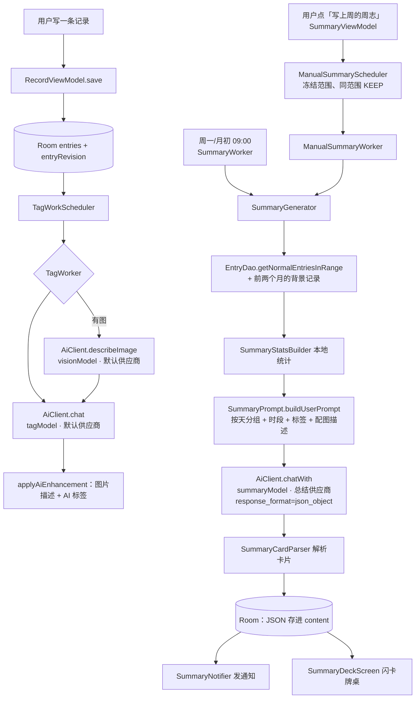

# Gift To Life · AI 调用链说明

> 对应版本：**4.7.0（versionCode 52）**
> 最后更新：2026-10-01
> 本文只描述**当前代码的真实行为**，不描述计划。历史版本见文末"变更记录"。

---

## 0. 一句话总览

App 里有 **3 个模型调用位**（标签、图片描述、总结），分**两组供应商**，全部走 OpenAI 兼容端点 `/v1/chat/completions`：

| 链路 | 供应商 | 触发方式 | 执行位置 |
|---|---|---|---|
| 图片描述 | 默认（标签/视觉） | 保存带图记录后自动 | WorkManager 后台 |
| 标签 | 默认（标签/视觉） | 同上，紧接着跑 | WorkManager 后台 |
| 周/月总结 | **可独立配置**（留空则跟随默认） | ① 用户点按钮 ② **每周一 / 每月 1 号 09:00 自动** | 手动与自动均由 WorkManager 持久执行 |



---

## 1. 公共底座

### 1.1 配置项（SharedPreferences `gift_settings`）

| 键 | 默认值 | 说明 |
|---|---|---|
| `api_key` | 空 | **默认供应商**的 Key（标签 + 视觉）；空则日常识别短路，总结可使用独立 Key |
| `base_url` | `https://api.deepseek.com` | 默认供应商地址 |
| `tag_model` | `deepseek-chat` | 标签模型 |
| `vision_model` | `deepseek-chat` | 图片描述模型 |
| `summary_api_key` | 空 | **总结供应商** Key；留空 = 跟随 `api_key` |
| `summary_base_url` | 空 | 总结供应商地址；留空 = 跟随 `base_url` |
| `summary_model` | `deepseek-chat` | 总结模型（写进总结条目 `summaryModel` 字段） |
| `auto_summary_enabled` | `true` | 每周一/每月初自动生成 + 通知 |

`BaseUrlValidator.normalize()`：去空白去尾斜杠、无协议补 `https://`、**必须 HTTPS**、禁止用户信息与 query、自动剥掉误填的 `/v1/chat/completions`。

### 1.2 网络层（`core/network/AiClient.kt`）

- Retrofit + Gson + OkHttp；**`connectTimeout = 30s`，`readTimeout = 180s`，`writeTimeout = 60s`**；按 baseUrl 缓存 Retrofit 实例。
- 端点：`@POST("v1/chat/completions")`，只有这一个接口。
- 结果映射：超时 / DNS / IO / HTTP 408·429·5xx → `RetryableFailure`；**401·403 → "API Key 无效"**；404 → "模型或地址不存在"；其他 4xx → `PermanentFailure`。
- 正文只取 `choices[0].message.content`；只回思考时是 `ReasoningOnly`，由总结解析器尝试捞定稿 JSON，绝不把思考当正文。
- `CancellationException` 与致命 `Error` 原样抛出，不归为可重试的网络失败。

### 1.3 调用参数

```kotlin
AiClient.chat(model, systemPrompt, userMessage,
    disableThinking = false,   // true → enable_thinking=false
    jsonMode = false,          // true → response_format={"type":"json_object"}
    maxTokens = 2048,
    temperature = 0.3)
```

| 用途 | model | max_tokens | temperature | response_format | thinking |
|---|---|---|---|---|---|
| 标签 | `tag_model` | 2048 | 0.3 | 无 | 关 |
| 图片描述 | `vision_model` | 300 | 0.3 | 无 | 关 |
| 总结 | `summary_model` | **8192**（400 时自动降回 2048） | **0.6** | **`json_object`** | **high + 思维链上限 2048**（设置里可切换）|

> `response_format` 是总结的硬要求：实测不加时约 50% 会把 JSON 包进 ``` 围栏、偶发非法 JSON 与超时。

---

## 2. 链路一：标签 + 图片描述（默认供应商，后台异步）

**入口**：`core/ai/TagWorkScheduler.kt` → `core/ai/TagWorker.kt`

- 三处触发，都在 `RecordViewModel`：新建记录（revision=0）、编辑正文/图片、替换图片。**用户手动改标签不投 AI**。
- 任务：`OneTimeWork` + `NetworkType.CONNECTED` + 指数退避 30s，唯一名 `tag_entry_<id>`，策略 `REPLACE`。
- 执行：空 Key 直接成功 → revision 校验 → 有图先 `describeImage`（base64 WebP 内联，`VisionPrompt.SYSTEM`，30 字以内）→ 再 `chat` 打标签（`TagPrompt.SYSTEM`，闪念/事记/情绪/知识）→ `applyAiEnhancement` 只替换 `AI_MANAGED` 四标签，**文摘（EXCERPT）永不覆盖**。

---

## 3. 链路二：周/月总结

### 3.1 触发

| 方式 | 说明 |
|---|---|
| 手动 | 无当前总结时：回忆 → 周志/月志 → 「写上周的周志 / 写上月的月志」；入队后可离页。已有总结时回忆行直接打开，历史入口进入列表 |
| **自动** | `SummaryWorker`：**每周一 09:00** 写上周、**每月 1 号 09:00** 写上月；写完发通知「上周的你，整理好了」 |
| 换一篇 | 牌桌右上角菜单「重新写一次」→ 确认；绑定原条目 id、起止日期与 updatedAt，不替换成最近周期 |

自动生成的排期是 `SummaryWorkScheduler`（一次性任务，启动 `KEEP`；终态 `APPEND_OR_REPLACE` 排后继，重试不另排）。「自动回顾」关掉只取消自动排期，不取消用户手动任务。

手动链路为 `ManualSummaryScheduler/Worker`：同范围唯一名 `KEEP`，输入只存范围/时区/原 id/修订时间/force，不存密钥；任务运行时读取设置。失败为终态，由用户显式重试；只有当前页主动加入的请求完成才自动打开，重新进入不会被旧完成任务带走。无通知权限时仍落库，只跳过提醒。

### 3.2 周期与输入

- 周志 = 上一自然周（周一 00:00 ~ 周日 23:59:59.999）；月志 = 上一自然月。
- **月志额外带上过去两个月**的记录作为背景（`# 更早的月份（背景资料，不要单独总结）`，没有记录的月份写「没有记录」）。新任务冻结时区；旧历史条目没有原时区，背景只采用与原月边界一致且候选无歧义的月份，不能确定时省略该背景，而不混入错误记录。
- 少于 **1 条**记录不生成（旧版阈值是 3，实测 1~2 条也能写出有内容的东西）。
- 输入渲染（`SummaryPrompt.buildUserPrompt`）：
  1. `# 本期客观数据`：条数、跨天数、最长连续、最活跃一天、时段分布、标签分布、配图数；
  2. 记录**按天分组**，每条带 `HH:mm 时段｜正文  [配图：描述]  #标签`；
  3. 总预算 48K 字符，超预算**按时间均匀抽样**（保住首尾，不再像旧版那样砍掉最新几天）；
  4. 记录只有 1~2 条时额外提示"不要罗列数据、不要拔高"。

### 3.3 输出契约（卡片 + 信件）

system prompt = `SummaryPrompt.WEEK_SYSTEM` / `MONTH_SYSTEM`（与 `.pi/lab/prompts/*/P1-*.md` 对齐）：

```
你是用户的私人记录回顾助手……（7~8 条写作铁律：只用真实信息、引用逐字、
禁止空泛抒情与意象堆砌、洞察必须由至少两条记录支持、如实描述不强行正能量）
输出契约：只输出一个 JSON 对象
{"keyword":"4-8 字", "cards":[fact|quote|insight…], "letter":"120-180 字 / 250-350 字"}
```

### 3.4 落库与展示

- 模型返回的 JSON **原样存进 `content` 字段**（TEXT）——不新增列、不改数据库版本，覆盖安装安全。
- 解析（`SummaryCardParser`）宽容处理 ``` 围栏与噪声；解析失败/旧数据 → `asPlainDeck` 按段落切卡并清掉 markdown 星号。
- 展示 = **闪卡牌桌**（`SummaryDeckScreen`）：封面（关键词 + 本地统计徽章）→ 事实/引语/洞察卡 → 信件卡；左右滑动翻卡，点卡片翻背面，信件卡点开整屏阅读。
- 卡片背面的内容**全部来自本地**：事实卡背面 = 统计怎么算的；引语卡背面 = 那句话前后的真实记录（"那前后你还写了"）；洞察卡背面 = 依据。
- 落库事务复核原总结 id/范围/updatedAt 及输入记录 id/entryRevision（含背景）；删除、导入替换或编辑后拒绝旧结果。完成后直接打开，不等待成功 Snackbar。
- 全文按钮、系统返回和顶栏返回先收起全文、保留牌桌页码；滑动/翻面教学学会后持久隐藏。
- 业务库与 WorkManager 不是跨库事务：落库后原版本校验防重复重写；远端已接收但本地未提交时被杀，恢复仍可能重复调用 API，不能保证外部请求恰好一次。

### 3.5 失败处理

| 情况 | 行为 |
|---|---|
| 网络慢/超时 | 手动任务失败终止，可显式再试；自动任务指数退避（10 分钟、最多 2 次） |
| Key 无效 / 其他 4xx | 普通总结页用短提示引导检查网络或模型设置；WorkManager 不持久化服务端原文、模型名或鉴权信息，连接诊断在 AI 配置页按需测试 |
| 服务商 400 参数错误 | 按四级梯子降级：预算 → JSON 模式 → 思考 → 输出上限，见 §6 |
| 模型没按格式返回 | 先按别名容错解析；实在不成形状就把文字捞出来当纯文本卡片（**最多 6 张**），不报"读不出来" |
| 只回了思考、没有正文 | 先**从思考里捞定稿 JSON**（从最后一版往前试）；捞不到则保留旧总结，普通页面显示短提示，不展示思考 |
| `finish_reason=length` | 解析已有正文 / 思考内定稿；无法得到有效内容则失败，不覆盖旧总结 |
| 没配 Key / 没记录 | 自动任务正常跳过；当前页主动手动请求显示短的未配置/无记录提示，不当失败重试 |

> 解析容错（4.4.1 加）：线上模型会飘字段名——实测返回过 `content`/`date`/`summary` 这套别名，
> 因此 `SummaryCardParser` 对 text/title/time/label/evidence/cards/letter/keyword 都做了别名兜底。

---

### 文风铁律（4.5.0 加，专治"每个字都对、但什么都没说"）

提示词里新增一段硬约束，包含**反例样本**（把真实产出的空话原句写进去当"不合格示例"）：

- ✗「这里既有复盘，也有很重的自我攻击；两者同时出现，你并没有把"不满意"轻轻放过。」
- ✗「在关系靠近和学业执行上，你都写到知道方向，却难以在现场行动。」

配套规则：删句测试（删了读者少知道什么，答不上来就删）、禁元评论（"这些内容留在这里"）、
禁虚词（其实／某种程度上／不得不说／或许／某种意义上／不是…而是…）、单句 ≤25 字、一段 ≤3 句、
每段 ≥2 个"只有这份记录才写得出来"的锚点、同一件事不在卡片和信里各说一遍、
字数天花板（周信 100-150 字、月信 240-320 字、卡片正文 ≤36 字）。

**实测（gpt-6-luna，同一周记录）**：

| | 信件 | 形态 |
|---|---|---|
| 加规则前 | 147 字 | "两件事放在一起看，问题不只在结果，而在你如何面对不确定、疏忽和停滞。" |
| 加规则后 | 91~149 字 | "9月18日，一边记下'干正事的时候不要听歌，这非常重要！！！'，一边只写'很帅啊'。" |

结论：**字数差不多，但句子的含金量完全不同**——臃肿的不是长度，是抽象名词叠加和元评论。
反例样本比正例管用得多（同样的模型，加正例块时没这效果）。

## 4. 已知问题与边界

| # | 状态 | 说明 |
|---|---|---|
| 1 | ✅ 已修（4.4.0） | 60s 读超时 → 180s，并对超时给重试入口 |
| 2 | ✅ 已修（4.4.0） | `max_tokens` 1024 → 2048 |
| 3 | ✅ 已修（4.4.0） | 总结带 `response_format=json_object`，围栏/非法 JSON 基本消失 |
| 4 | ✅ 已修（4.4.0） | 图片描述现在只要存在就进总结（不再"仅正文为空时"） |
| 5 | ✅ 已修（4.4.0） | 48K 预算改成均匀抽样，不再丢最新几天 |
| 6 | ✅ 已修（4.4.0） | 周志不再随机二选一；卡片契约固定 |
| 7 | ⏳ 未做 | 总结之间（跨期）除了月志的"前两个月背景"外没有更长的记忆 |
| 8 | ⏳ 未做 | 卡片不能分享成图片 |
| 9 | ✅ 已修（4.4.4） | 思考强度已开放配置，默认 high + 2048 预算；兼容参数四级降级 |
| 10 | ⚠️ 注意 | SiliconFlow 上 `tencent/Hy4-preview` 与 `deepseek-ai/DeepSeek-V4-Flash` **都不是 VLM**，喂图会 400 |

---

## 5. 试验台（`.pi/lab/`）对应关系

| 试验台 | 线上 |
|---|---|
| `lab.py: render_M0` | 旧版 `buildUserPrompt`（**已不是线上行为**，仅作历史对照） |
| `lab.py: render_M1/M2/M3` | 4.4.0 的新输入渲染（按天分组 + 客观数据 + 配图描述） |
| `prompts/weekly/P1-cards.md`、`monthly/P1-cards-letter.md` | 线上 `WEEK_SYSTEM` / `MONTH_SYSTEM` |
| `run.py` 的 `response_format` / `thinking_budget` | 线上已有 `response_format`；`thinking_budget` 尚未开放 |

> 线上改提示词后，**同步更新 `.pi/lab/prompts/` 并重跑对比**，否则试验结论不再代表线上。

---

## 6. 思考怎么设（2026-09-25 实测，`tencent/Hy4-preview` @ SiliconFlow）

设置页「AI 配置 → 总结 → 思考强度」三档：**不思考 / 思考（默认）/ 深度思考**。
同一个 8 条记录的周志输入，实测：

| 设置 | 实际发出的参数 | 思考 token | 耗时 | 结果 |
|---|---|---|---|---|
| 不思考 | `enable_thinking=false` | 0 | **8s** | JSON 正常 |
| 思考（默认） | `reasoning_effort=high` + `thinking={type:enabled}` + `thinking_budget=2048` | 2,046（被上限截住） | **47s** | JSON 正常 |
| 深度思考 | 同上但**不给** `thinking_budget` | 7,743 ~ 19,095 | **127s ~ 350s** | 会超 180s 读超时 |

（月志 2 万字输入，默认档 46s、思考 2,046 token、JSON 正常。）

三条经验：

1. **思考要留着，但必须给上限**。不给上限时思维链能到 1.9 万 token，
   既慢又贵，还会把输出预算吃光导致正文为空（4.4.2~4.4.3 线上就是这么炸的）。
2. **思考块不当作答案，但值得捞**。模型常在思考里写好几种草稿，最后一版就是定稿；
   `SummaryCardParser.parseDetailed()` 从最后一版往前试，捞到就用。
   （4.4.2 之前 `AiClient` 是 `content 为空 → 直接退回 reasoning_content`，
   于是卡片里出现过模型自言自语 "Card 3 (insight): … Let me count …"，这是线上事故，已修。）
3. **参数名各家不同**，所以三种一起发、不认就删：
   `thinking_budget`（SiliconFlow 风格）、`reasoning_effort`（DeepSeek/OpenAI 风格）、
   `thinking={type:enabled}`（DeepSeek 官方风格）。

### 模型选型的实测（2026-09-25，周志 8 条记录 / 输入 8.2k 字）

| 模型与设置 | 首字延迟 | 生成速度 | 输出 token | 总时长 |
|---|---|---|---|---|
| `tencent/Hy4-preview` 不思考 | ~2s | ~70 tok/s | 320 | **8s** |
| `tencent/Hy4-preview` 思考 high + 预算 2048 | — | — | 2,629（思考 2,046）| 47s |
| `tencent/Hy4-preview` 默认思考（无上限）| — | — | 16,243（思考 15,900）| 273s |
| **`gpt-6-luna` @ 4Router** | **15~22s** | 27ms/token | **588（思考 277）** | 22~31s |

- **luna 的 token 效率最高**：输出是 Hy4 的 1/4.5，思考只有 277 token。
- **但 luna 的首字延迟是 15~22s，与输入长度、与思考开关无关**（20 字提问也要 15.5s；
  `reasoning_effort=none` / `thinking:{type:disabled}` 都一样）——**这是 4Router 中转的固定排队延迟**，不是模型的锅。
- 月志（2 万字输入）：46s / 1,496 token（思考 940），JSON 正常，卡片与信件质量在实测里最好。
- 参数兼容：`reasoning_effort=high` + `thinking={type:enabled}` + `thinking_budget=2048` +
  `response_format` 这套全接受，`enable_thinking=false` 也接受。

**结论**：耗时 = 供应商固定延迟 + 输出 token × 每 token 时间。
要压时间只能压第二项（选不话痨的模型）或换掉第一项（供应商/流式）。
公开速度榜（Gemini Flash-Lite ~390 tok/s、Ling 3.0 Flash ~397 tok/s 之类）衡量的正是"每 token 时间"，
在我们这种"几百个 token + 十几秒排队"的场景里不是决定项。

### 参数降级梯子（`SummaryCallPlan.degraded`）

服务商返回 400 时**逐级丢弃**再试，不占重试次数：

| 级 | 丢掉什么 | 触发场景 |
|---|---|---|
| 1 | `thinking_budget` | 服务商不认这个字段 |
| 2 | `response_format` | 服务商不认 JSON 模式（SiliconFlow 报 "The parameter is invalid"）|
| 3 | 整个思考（`reasoning_effort` / `thinking`）| 服务商不认这两个字段 |
| 4 | `max_tokens` 降到 2048 | 服务商嫌 8192 超过模型上限 |

## 7. 变更记录

- **4.7.0（2026-10-01）**：手动总结统一持久 WorkManager；精确历史对象/范围/修订保护、源输入事务复核、自动任务安全排后继；取消原样传播；配置统一草稿整组保存；月名与背景跨时区校正。192 个 JVM 单测通过，设备及真实 AI 尚未验证。
- **选型笔记（2026-09-25）**：总结模型用 `gpt-6-luna`（4Router，`https://4router.net/v1`）；见上面实测表。
- **4.5.0（2026-09-26）**：提示词加文风铁律（反例+删句测试+禁元评论/虚词+字数天花板）；牌桌改版（定高牌框+堆叠层次+字号三档+超长提示），修复背面露出 markdown 的问题。
- **4.4.4（2026-09-25）**：思考强度做成设置项（不思考 / 思考 / 深度思考，默认思考+上限 2048）；思考参数按 DeepSeek/SiliconFlow 两种风格同时发；400 时走参数降级梯子逐级丢弃。
- **4.4.3（2026-09-25）**：输出上限 3000→8192（400 自动降到 2048）；只回思考时从思考里捞定稿 JSON（从最后一版往前试）；`AiResult` 新增 `ReasoningOnly`；测试连接会提示"模型只回了思考"。
- **4.4.2（2026-09-25）**：总结关思考；不再把 `reasoning_content` 当答案；输出被截断/只有思考时给明确原因；纯文本兜底限 6 张卡。
- **4.4.1（2026-09-25）**：HTTP 错误带出服务端原文与模型名；400 时自动去掉 `response_format` 重试；解析器字段别名容错。
- **4.4.0（2026-09-24）**：总结链路整体重做。新增卡片契约与牌桌 UI、双供应商、后台自动生成 + 通知、`response_format`/`max_tokens`/超时调整、月志三个月背景、阈值 3→1、低密度降级、旧数据兼容。
- 4.0.0 之前：单供应商；总结为纯文本（时光切片 / 情绪天气报告 / 老友信），随机二选一，60s 超时。
